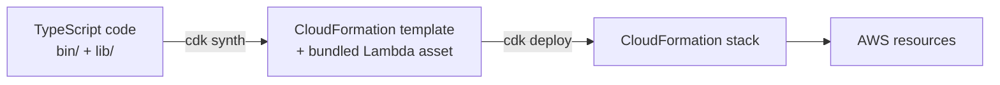

# CDK & TypeScript primer for Terraform users

A tour of this repository for someone fluent in Terraform and new to TypeScript. Every example is taken from the code here.

## CDK in one picture



CDK is a code generator. Your TypeScript runs, builds an in-memory tree of *constructs*, and **synthesizes** a CloudFormation template. CloudFormation then does the actual create/update/delete and keeps the state.

## Terraform → CDK mapping

| Terraform | CDK | Notes |
|---|---|---|
| `resource` block | L1 construct (`CfnFunction`) | 1:1 with a CloudFormation resource type. |
| — | L2 construct (`lambda.Function`) | Higher-level, with sane defaults and helpers like `grant*()` and `addToRolePolicy()`. Most code uses these. |
| Module | L3 construct / pattern, or your own `Construct` subclass | `NodejsFunction` is an L3: function + esbuild bundling. |
| Root module | `Stack` | One stack = one CloudFormation stack = the unit of deployment. |
| `terraform plan` | `cdk diff` | |
| `terraform apply` | `cdk deploy` | CloudFormation applies the change set, and rolls back on failure. |
| `terraform.tfstate` + S3 backend | The CloudFormation stack itself | No state file to store or lock. AWS keeps it. |
| `variable` / `.tfvars` | Context in `cdk.json`, or stack props | This repo reads `context.gateway` in `lib/config.ts`. |
| `output` | `CfnOutput` | |
| `terraform init` (providers) | `cdk bootstrap` (once per account/region) | Creates the asset bucket, ECR repo and deployment roles CDK uses. |
| `depends_on` | Usually implicit | Passing one construct to another creates the dependency. |

**Mental model.** In Terraform you *declare* resources. In CDK you *write a program that declares resources*. Loops, functions, types and tests are just the language. `modelInvokeStatements()` in `lib/bedrock-permissions.ts` is a plain function returning IAM statements, which you couldn't express as cleanly in HCL.

## Project files

| File | Role |
|---|---|
| `package.json` | Dependencies and scripts (`npm test`, `npm run typecheck`). Comparable to `requirements.txt` plus a Justfile. |
| `package-lock.json` | Exact resolved versions. Commit it, and use `npm ci` in CI. Comparable to `.terraform.lock.hcl`. |
| `tsconfig.json` | TypeScript compiler settings. `strict: true` is on. |
| `cdk.json` | How to run the app (`npx tsx bin/...`) plus context values and feature flags. |
| `node_modules/` | Installed packages (gitignored). Comparable to `.terraform/`. |
| `cdk.out/` | Synthesized templates and bundled assets (gitignored). |

## TypeScript you'll see in this repo

**Imports.** These are ES module syntax. `import type` imports only types, which disappear at runtime:

```typescript
import * as lambda from 'aws-cdk-lib/aws-lambda';          // whole module as a namespace
import { Logger } from '@aws-lambda-powertools/logger';     // one named export
import type { APIGatewayProxyEvent } from 'aws-lambda';      // types only
```

**Interfaces** describe the shape of an object. `readonly` means it can't be reassigned after creation, and `?` means optional:

```typescript
export interface Source {
  readonly id: number;
  readonly text: string;
  readonly location?: string;   // string | undefined
}
```

**Classes and `extends`.** Every construct follows the same constructor signature: `(scope, id, props)`. The scope is the parent in the construct tree, and the id is unique among its siblings:

```typescript
export class BedrockAiGatewayStack extends cdk.Stack {
  constructor(scope: Construct, id: string, props: BedrockAiGatewayStackProps) {
    super(scope, id, props);   // call the parent class constructor first
    // ...create child constructs with `this` as their scope
  }
}
```

**`unknown` and narrowing.** Parsed JSON is `unknown`, so TypeScript won't let you use it until you prove its type. This is how `request.ts` validates input:

```typescript
const parsed: unknown = JSON.parse(body);
if (typeof parsed !== 'object' || parsed === null) throw new ValidationError('...');
// from here on, TypeScript knows parsed is an object
```

**Optional chaining and nullish coalescing.** SDK responses are full of optional fields:

```typescript
const inputTokens = output.usage?.inputTokens ?? 0;
// ?.  → stop and return undefined if `usage` is missing
// ??  → use 0 if the left side is null or undefined
```

**`async` / `await`.** Network calls return a `Promise`. `await` pauses until it resolves, so async code reads top to bottom like synchronous code. A handler must be `async` to use `await`:

```typescript
export const handler = async (event: APIGatewayProxyEvent, context: Context) => {
  const retrieval = await agentRuntime.send(new RetrieveCommand({ /* ... */ }));
};
```

**AWS SDK v3 pattern.** Create a client once, then `send()` command objects. Clients are created outside the handler so warm invocations reuse them:

```typescript
const bedrock = new BedrockRuntimeClient({});              // region + credentials from the Lambda environment
const output = await bedrock.send(new ConverseCommand(input));
```

**`as const`** freezes an object literal and keeps its exact values as types (see `LIMITS` in `request.ts`).

## How the Lambda gets built

`NodejsFunction` runs **esbuild** during `cdk synth`. Starting from `src/chat/handler.ts`, it follows imports, tree-shakes unused code and writes one minified `index.js` into `cdk.out/`. The `@aws-sdk/*` packages are left out by default because the Node.js Lambda runtime already includes them. That's why the bundle is around 30 KB.

## Tests

| File | What it tests | AWS needed? |
|---|---|---|
| `test/request.test.ts` | Input validation, including table-driven bad cases (`test.each`) | No |
| `test/rag.test.ts` | Prompt and Converse request construction | No |
| `test/handler.test.ts` | Handler flow with Bedrock mocked by `aws-sdk-client-mock` | No |
| `test/stack.test.ts` | Synthesized template: runtime, API key, IAM scoping, no wildcard actions | No |

CDK assertion tests (`Template.fromStack`) are the CDK equivalent of `terraform test` or policy checks on a plan. They catch infrastructure regressions in milliseconds.

## Everyday commands

```bash
npm test -- --watch          # rerun tests on save
npx cdk synth > /dev/null    # quick "does it build?" check
npx cdk diff                 # what would change
npx cdk deploy --hotswap     # dev only: push Lambda code changes without a full CloudFormation update
```

> [!WARNING]
> `--hotswap` deliberately creates drift between CloudFormation and reality. Never use it against shared or production stacks.

## Related

- [How it works](how-it-works.md)
