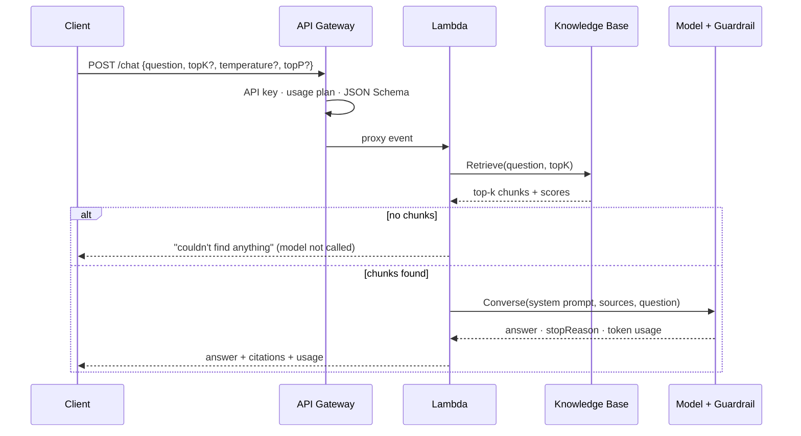

# How the Bedrock AI Gateway works

This note walks one request through the system and explains the generative-AI concepts each step depends on. Code references point into `src/chat/`.

## The request lifecycle

## Retrieval concepts

**Embeddings.** An embedding model turns text into a vector, a list of numbers (1,024 for Titan Text Embeddings v2), where similar meanings land close together. "PTO" and "vacation days" end up near each other even though they share no words. That is the difference between *semantic* search and keyword search.

**Chunking.** Documents are split into chunks before embedding, because a model can only use a limited amount of text, and a precise chunk retrieves better than a whole document. Chunks that are too small lose context; chunks that are too large dilute the match and waste tokens. The Knowledge Base handles chunking at ingestion time.

**Vector search and top-k.** At query time the question is embedded with the same model, and the vector store returns the `k` nearest chunks by similarity. `topK` in this API controls that number:

- Low k: cheaper and more focused, but the answer may live in chunk k+1.
- High k: better recall, but more input tokens (cost and latency) and more irrelevant text for the model to sift through.

The `usage.inputTokens` field in the response makes this trade-off visible.

## Generation concepts

**System prompt vs user content.** Instructions go in the `system` field (`SYSTEM_PROMPT` in `rag.ts`). The sources and question go in the user turn as separate blocks. The prompt tells the model to answer only from the sources, to cite them as `[n]`, and to treat the sources and question as data rather than instructions.

**Grounding.** An answer is *grounded* when every claim is supported by the provided sources. The prompt asks for it, the citations make it checkable, and the guardrail enforces it (below). A model answering from its training data instead of the sources is the RAG form of **hallucination**.

**Sampling controls.** A model predicts a probability for every possible next token, then samples one:

| Setting | What it does | This API's default |
|---|---|---|
| `temperature` | Flattens (high) or sharpens (low) the probability distribution. Low means more deterministic. | `0.2`, since factual answers shouldn't be creative |
| `topP` | Samples only from the smallest set of tokens whose probabilities add up to *p* (nucleus sampling). | `0.9` |
| `maxTokens` | Hard cap on output length, and so on output cost. | `512` |

Tune temperature *or* top-p, not both at once. They interact, and changing both makes behaviour hard to reason about.

> [!NOTE]
> `topK` in this API is the retrieval *top-k* (how many chunks). Some models also have a sampling *top-k* (consider only the k most likely tokens). Same name, different layer.

**Tokens and cost.** Bedrock on-demand pricing is per input and output token. Input usually dominates in RAG, because every retrieved chunk is sent to the model. Logging both counts per request is the basis for per-consumer cost attribution.

## Safety controls

The Guardrail is attached to the `Converse` call (`guardrailConfig` in `rag.ts`) and evaluates both directions:

| Risk | Control |
|---|---|
| **Prompt injection / jailbreak.** Text that tries to override instructions ("ignore previous instructions…"). | Prompt-attack filter on the input. Plus the system prompt treats user text as data. |
| **Harmful content** | Content filters (hate, violence, sexual content, misconduct) on input and output |
| **Off-limits topics** | Denied topics (e.g. legal advice), defined in natural language |
| **Sensitive data** | PII detection: block secrets and card numbers, mask emails and phone numbers |
| **Hallucination** | Contextual grounding check: scores the answer against the `grounding_source` block and blocks it below the threshold |
| **Irrelevance** | Relevance check: scores the answer against the `query` block |

The `guardContent` blocks with `qualifiers` tell the guardrail what each piece of text is, and **each qualifier enables different checks**:

| Qualifier | Used by | Input filters (prompt attack, PII, content, topics) run on it? |
|---|---|---|
| `grounding_source` | Contextual grounding check | No |
| `query` | Relevance check | **No** |
| `guard_content` | Input filters | Yes |

The question therefore carries **both** `query` and `guard_content` (`rag.ts`). That way it's scored for relevance *and* screened for attacks and PII before the model sees it.

> [!WARNING] Finding from red-teaming (2026-10-10)
> The first version tagged the question with `query` only. Attacking the live endpoint showed that a prompt-injection attempt and a question containing a US Social Security number both reached the model with **no input-guardrail intervention**. Calling `ApplyGuardrail` directly confirmed the cause: `query`-tagged text is skipped by the input filters. Defense in depth limited the damage: the system prompt refused the injection, and the output-side guardrail blocked answers on denied topics. But the SSN had already been sent to the model. Adding `guard_content` fixed it, and the fix was verified against the live endpoint. Unit tests with a mocked Bedrock could not have found this; only testing against the real guardrail did.
>
> Still open: retrieved chunks are tagged `grounding_source` only, so the input filters don't screen them. That matters for **indirect prompt injection**, where malicious instructions are planted inside a document. The current mitigations are that the corpus changes only through reviewed pull requests, and that the system prompt treats sources as data.

When the guardrail intervenes, `stopReason` is `guardrail_intervened`, the answer is replaced with the guardrail's configured message, and the gateway returns `guardrailIntervened: true` with no sources.

Before any of this, the gateway skips the model entirely when retrieval finds nothing. That is the cheapest hallucination control there is.

## Platform controls

These have nothing to do with AI, but they are what make the gateway safe to share between teams:

- **Identity per consumer.** API keys map callers to usage plans. An API key *identifies* a consumer; it doesn't *authenticate* one. It's a static string, and anyone holding it can use it. For production callers, add IAM (SigV4), a JWT/Cognito authorizer, or a Lambda authorizer, and keep API keys for usage plans only.
- **Rate limits and quotas.** Per-key throttling and a daily quota cap request volume. API Gateway checks them before body validation, so throttled requests never reach Lambda or Bedrock. These limits are **best effort, not exact**: in testing, a burst of 20 simultaneous requests all got through before throttling kicked in and over-corrected. Treat usage plans as fairness between consumers, not a spending cap. Hard cost controls belong in Lambda reserved concurrency, Bedrock service quotas, AWS Budgets alerts, or a WAF rate rule.
- **Input validation.** At the edge (JSON Schema) and again in the function.
- **Least privilege.** The function can call only the configured model, Knowledge Base and Guardrail.
- **Tracing and structured logs.** X-Ray traces and JSON logs (Powertools Logger) with token counts and guardrail outcomes.

## Related

- [CDK & TypeScript primer](cdk-typescript-primer.md)
- Guardrail and Knowledge Base definitions: [infra-cloud-deployments](https://github.com/bar2sek/infra-cloud-deployments) (`terraform/aws/bedrock-*.tf`)
