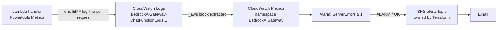

# Observability: Metrics, Logs and Alarms

The chat function reports what it does with **Embedded Metric Format (EMF)**. After each request it writes one JSON log line. CloudWatch turns the `_aws` block in that line into metrics, and the line itself stays searchable in the logs. One write produces both the graph and the request behind it.



**Why EMF rather than `PutMetricData`:** EMF is a log write, so it needs no extra IAM permission (the permissions boundary already allows logs) and adds no API call or latency to the request.

## Metrics

Namespace `BedrockAiGateway`, dimension `service=ai-gateway`.

| Metric | Recorded when | Use it to answer |
|---|---|---|
| `Latency` (ms) | every answered request | "Is it slow?" Use p90/p99; the average hides outliers |
| `InputTokens`, `OutputTokens` | every model call | Cost and unusually large prompts (see the caveat below) |
| `GuardrailInterventions` | 0 or 1 per request | **Sum** = blocked requests; **Average** = block rate. A spike can mean probing |
| `NoContextAnswers` | retrieval returned nothing | Knowledge Base empty or ingestion failed |
| `BedrockThrottles` | Bedrock returned `ThrottlingException` (HTTP 429) | Hitting model quotas |
| `ServerErrors` | any other failure (HTTP 502) | Real failures. **Lambda's built-in `Errors` stays at 0** because the handler catches every error |
| `ColdStart` | first request on a new execution environment | Explaining occasional slow requests |

Bad input (HTTP 400) records nothing; API Gateway's `4XXError` metric covers it.

## Troubleshooting workflow: metric → logs

1. **Spot it in metrics.** CloudWatch → Metrics → `BedrockAiGateway`. Is the block rate up, p90 latency up, or `ServerErrors` non-zero?
2. **Find the requests in logs.** CloudWatch → Logs Insights, log group `BedrockAiGateway-ChatFunctionLogs…`:

```sql
-- Each request's outcome
filter message = "Chat completed"
| fields @timestamp, stopReason, sourceCount, guardrailIntervened, inputTokens, outputTokens
| sort @timestamp desc
```

```sql
-- The metric values exactly as emitted (EMF lines)
filter ispresent(Latency)
| fields @timestamp, Latency, InputTokens, OutputTokens, GuardrailInterventions, NoContextAnswers
| sort @timestamp desc
```

```sql
-- What failed (the alarm's description points here)
filter message = "Chat request failed"
| fields @timestamp, error.name, error.message
| sort @timestamp desc
```

## Alarm: `ServerErrors`

| Setting | Value | Why |
|---|---|---|
| Statistic / period | `Sum` over 5 minutes | Each failure records 1, so Sum is the failure count |
| Threshold | ≥ 1, one period | Any 502 means Bedrock or the Knowledge Base is failing |
| Missing data | `notBreaching` | The metric only exists when something failed, so no data means healthy. Without this, the alarm sits in `INSUFFICIENT_DATA` or alerts falsely |
| Actions | ALARM **and** OK → alerts topic | The OK email tells you it recovered and how long the outage lasted |

- **Notifications** go to a shared SNS topic owned by Terraform in the `personal-technology` repository. That keeps the subscriber email out of this repository, its CloudFormation templates and its public CI logs. The stack references the topic by name (`cdk.json` → `gateway.alertTopicName`).
- **No `alarmName`.** CloudFormation generates `BedrockAiGateway-…`, the only alarm prefix the CDK bootstrap's execution policy allows.

**Verification (2026-10-11):** forcing the state with `aws cloudwatch set-alarm-state --state-value ALARM` delivered an ALARM email, followed by an OK email once the alarm re-evaluated the real metric.

```bash
aws cloudwatch set-alarm-state --region us-east-2 \
  --alarm-name "$(aws cloudwatch describe-alarms --region us-east-2 --alarm-name-prefix BedrockAiGateway-ServerErrors --query 'MetricAlarms[0].AlarmName' --output text)" \
  --state-value ALARM --state-reason "Manual test of the alert path"
```

## Findings from the first live data (2026-10-11)

Five test requests: three policy questions, one off-topic question, one prompt attack.

> [!WARNING] Token metrics undercount when the guardrail intervenes
> Blocked responses report `inputTokens: 0` and `outputTokens: 0`, even when the model ran: the grounding-blocked request was the slowest of the five, at 2.4 s. Treat token metrics as a lower bound on cost.

> [!NOTE] `NoContextAnswers` only fires on an empty index
> Vector search always returns the *nearest* chunks, however irrelevant. An off-topic question still retrieved 4 chunks. The model correctly said it didn't know, but still cited `[1][2]`. Candidate fix: drop chunks below a minimum relevance `score` before calling the model.

> [!NOTE] A normal question was blocked by the grounding check
> "What is the remote work policy?" was blocked as unsupported by the handbook. Either the handbook covers remote work thinly, or the answer went beyond the sources. Worth reviewing against the source documents and the grounding threshold.
